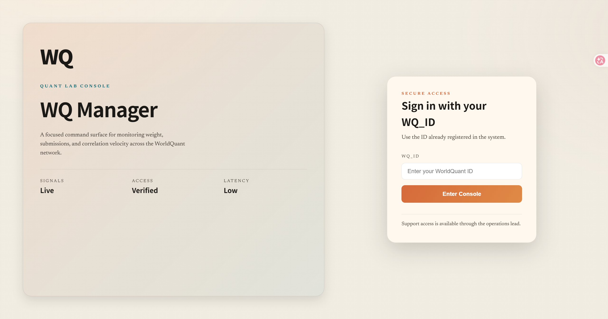
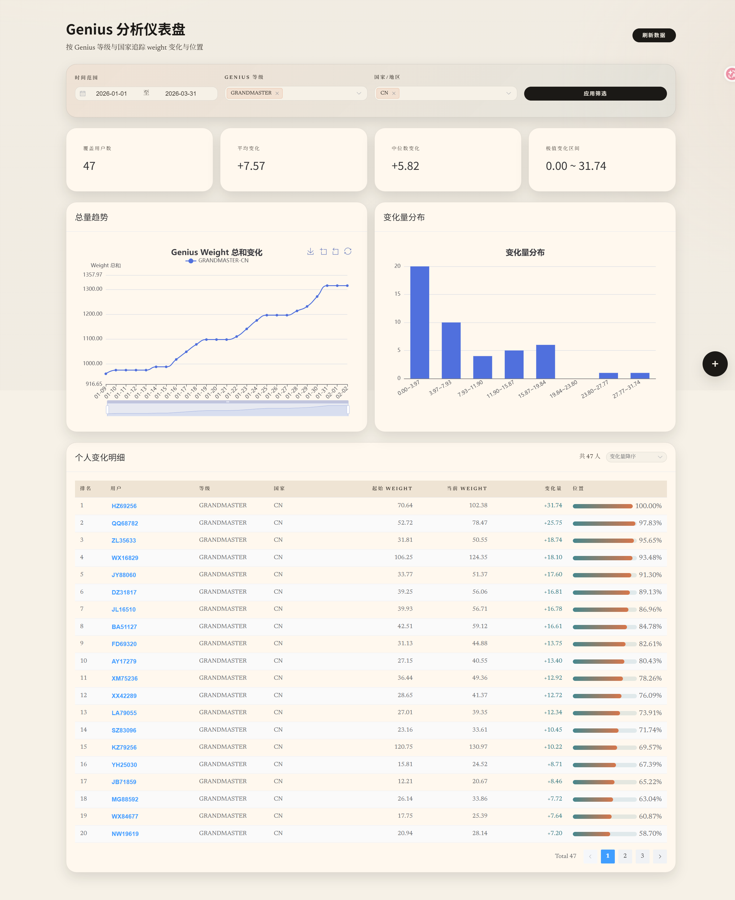
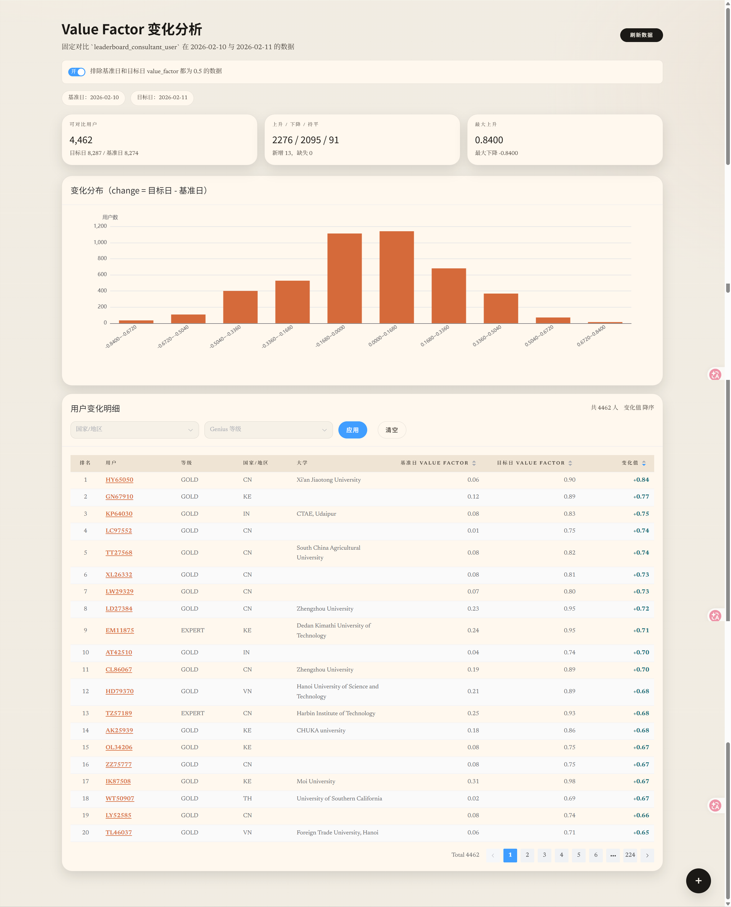
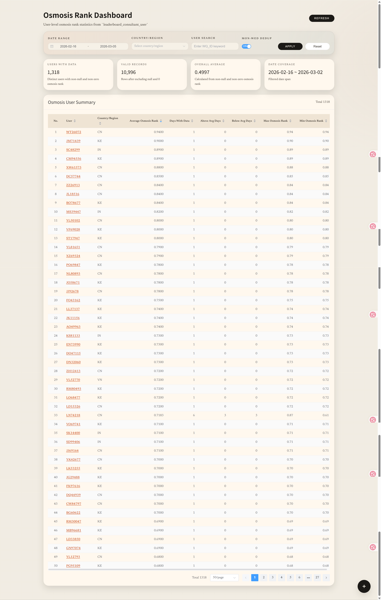
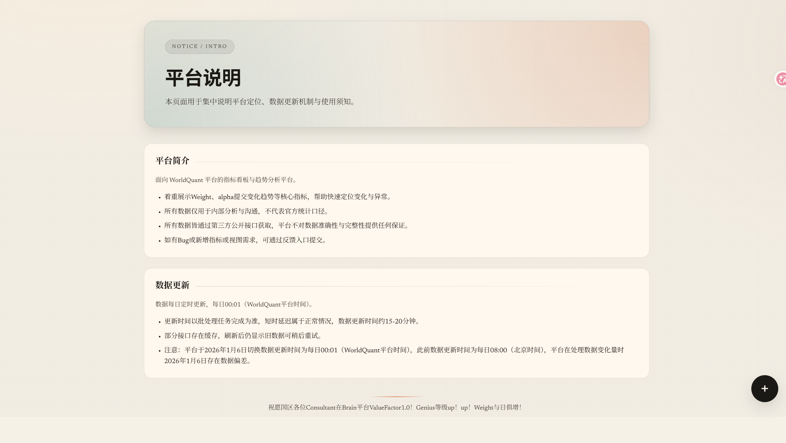

# WQ Manager Frontend

基于 Vue 3 + TypeScript 的前端项目，提供看板、趋势、个人中心、Genius 仪表盘等页面。

在线体验：https://wqmanager.qzz.io/

## 技术栈

- Vue 3 / TypeScript
- Vite
- Element Plus
- Axios

## 本地开发

```bash
npm install
npm run dev
```

默认端口：`http://localhost:5173`  
开发环境下，`/api` 会代理到 `http://localhost:8000`（见 `vite.config.ts`）。

## 构建

```bash
npm run build
```

产物位于 `dist/`。

## 网站访问统计

项目已在 `index.html` 中接入 Umami，统计后台为 https://umami.wqmanager.icu/。

- 仅统计 `wqmanager.icu` 的访问，本地开发和其他域名不计入统计。
- 页面访问和 Vue Router 页面切换由 Umami 自动记录。
- 统计服务需使用覆盖 `umami.wqmanager.icu` 的有效 HTTPS 证书，否则浏览器会阻止加载统计脚本。
- 更换统计服务或网站时，修改 `index.html` 中的 `src`、`data-website-id` 和 `data-domains`，然后重新构建并发布前端。

上线后，在浏览器 Network 面板确认 `script.js` 加载成功、`/api/send` 请求成功，并查看 Umami 实时数据。

## Docker 构建与启动

在 `frontend/` 目录执行：

```bash
docker build -t wq-frontend .
docker run -d --name wq-frontend -p 80:80 -p 443:443 \
  -v /opt/project/wq-manager/ssl:/etc/nginx/ssl:ro \
  wq-frontend
```

> 若无需 HTTPS，可去掉 `-p 443:443` 与证书挂载。

## Submit请等等

通过浮动菜单中的“Submit请等等”进入，或登录后访问 `/submit-wait`。页面支持 Alpha 文字与图片发布、匿名广场、好友小组、独立投票与理由、送花、作者最终决定和个人统计。申请链接支持 `/submit-wait?post=申请ID` 直接打开详情。

首页使用“不行了，不行了，忍不住了，到底能不能交哇？”作为标题下的引导语，主按钮为「发布我的 Alpha 评审」。评审选项统一使用「交！它已经绿了！」与「管住手哇！」，按钮、票数统计和评审意见共用同一份文案。

「随机抽卡」从当前公开广场或已选小组的全部可评审申请中随机抽取，不受当前分页、排序或个人列表影响；遵守屏蔽词，并排除自己的、已评审、已围观、已结束及已撤回的申请。抽卡只打开详情，不会评审或围观；有其他候选时，「再抽一张」会避开上次抽到的申请。没有候选时给出提示。

右上方的评审指南每 2 秒自动切换，支持手动切换、暂停，悬停或键盘聚焦时暂停；也会遵循系统的减少动态效果设置。广场宽屏每行 3 张卡片，平板每行 2 张，手机每行 1 张。发布窗口在说明、截图和发布按钮附近提示用户先隐藏表达式、源代码、账号和密钥等敏感信息，匿名发布不会自动脱敏。

广场由后端按已评人数从高到低排序，同人数按最新发布优先，分页保持该顺序。热度根据已评人数分为 5 人「热议」、15 人「火热」、30 人「火爆」、50 人「超火爆」，不足 5 人不显示标识；卡片与详情共用同一套阈值。

卡片和详情均可选择「围观」。确认前会提示：围观后可查看大家的意见，但永久失去这条申请的评审资格。后端持久化该选择并禁止后续评审，刷新或更换设备不会恢复资格；对其他申请没有影响。围观人数单独显示，不计入已评人数或热度；「我在围观」可找回已围观的申请。作者与已评审者可直接查看意见，已结束的申请也可围观。

图片最多 9 张，每张不超过 10MB。打开发布窗口后，可直接按 Ctrl+V（Mac：⌘V）粘贴截图，也可选择本地图片；粘贴后显示预览，点击发布时统一上传。纯文字粘贴保持正常。发布失败会保留草稿；上传成功但发布失败时，重试会复用当前草稿中的图片 ID。关闭发布窗口会清空草稿。屏蔽词按当前用户保存在本浏览器，只应用于广场。

评审理由支持自定义图片表情：点击「添加表情」打开面板，点选或取消；发送前可预览、移除，每次最多 3 张，文字理由仍必填。首批为「忍不住了」和「赶紧交它一个」，保留用户原图和宽高比例。评审意见内可点击表情查看大图；未评审或围观前仍无法查看他人的意见及表情。加载失败可重试，提交失败保留文字与表情草稿。图片通过后端授权从线上 MinIO 读取。

上线前须先执行后端的 `migrations/20261015_create_submit_wait.sql`，并确认后端能够访问配置的 MinIO API。图片通过后端授权读取，支持私有桶。开发时默认通过 Vite 的 `/api` 代理访问本机 8000 端口。

## 接口配置

Axios 默认配置位于 `src/api/client.ts`：
- `baseURL: /api/v1`
- `timeout: 30000`（30s）

生产环境下由 Nginx 代理 `/api/` 到后端服务。

## Nginx 部署

生产环境使用 `frontend/nginx.conf`：
- 静态资源根目录 `/usr/share/nginx/html`
- `/api/` 反向代理到后端容器
- 已支持 HTTPS（证书通过 volume 挂载）

如需修改域名或证书路径，请更新该文件并重建前端容器。

## 相关截图
- Login


- Home


- Genius


- Trend


- Profile


- Value Factory


- Combined


- Osmosis


- Consultant


- Feedback


- Notice



## Star History

[](https://www.star-history.com/?repos=Worldfickler%2FWQ-MANAGER-frontend&type=date&legend=top-left)
